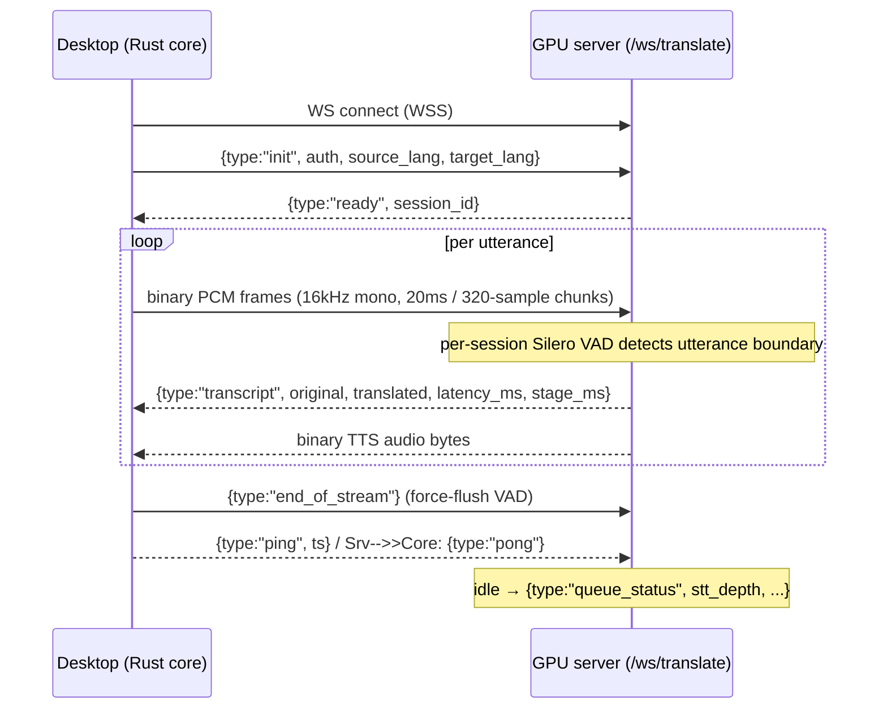

# Bridge — Stage 2 Design Doc

**Document type:** Stage 2 architecture design (delta over TRD v0.2)
**Version:** 0.1
**Companion to:** Bridge TRD v0.2, Bridge Roadmap v0.1
**Last updated:** 2026-06-04
**Owner:** Salvation
**Decision basis:** Council review `docs/decisions/2026-06-04-stage2-architecture.md`

> This document captures **only what the Stage 1 spike changed.** Everything not listed
> here — audio driver, Rust core / audio engine, Tauri UI, the §3.5 risk ranking, the §11
> failure modes, device hot-swap, the kill-switch / passthrough philosophy — remains as
> specified in **TRD v0.2** and is still authoritative. A full TRD v0.3 merge is deferred
> until Stage 2 build actually starts.

---

## 1. Purpose & Relationship to TRD v0.2

TRD v0.2 was written on **May 19, 2026 — before** the Stage 1 spike produced any measured
numbers. Its core build-vs-buy decision (buy cloud STT/MT/TTS; backend must *not* proxy
audio) was an assumption. The spike measured reality, and reality pointed the other way:
the self-hosted GPU stack hit the latency and accuracy targets; the cloud chain did not.

This doc records that pivot and the topology/protocol/security consequences that follow
from it.

**Sections this doc SUPERSEDES in TRD v0.2:**

| TRD v0.2 section | Superseded by | What changed |
|---|---|---|
| §12 Build vs Buy (STT/MT/TTS = Buy) | §3 here | STT/MT/TTS now **self-hosted on GPU**; cloud is fallback only |
| §4.4 Cloud Bridge & Provider Adapters | §5 here | Desktop no longer talks to provider clouds directly; it talks to **our GPU server** over WebSocket |
| §4.6 / §3-principle "backend does NOT proxy audio" | §5, §8 here | **Reversed.** Our GPU server is now in the audio path — bounded, not eliminated |
| §6 Latency Architecture (cloud line items) | §7 here | Per-stage budget replaced with **measured self-hosted GPU timings** |
| §10 Deployment Topology (AWS/ECS only) | §4 here | Adds the **GPU translation server** topology (RunPod persistent T4) |

**Sections that REMAIN authoritative in TRD v0.2:** §3.5 (risk ranking — audio reliability
is still #1), §4.1/§4.2 (driver + Rust audio engine), §4.3 (per-direction orchestrator
state machine), §4.5 (Tauri UI), §4.7 (Conversation Manager, reserved), §11 (failure modes),
§13 (spike validation plan).

---

## 2. Stage 1 Evidence (Measured, Not Assumed)

All numbers below come from committed run data, not estimates.

### Self-hosted GPU stack — the winner

`Silero VAD → Faster-Whisper small (float16) → Opus-MT es→en → Piper TTS`

| Metric | Value | Source |
|---|---|---|
| End-to-end P50 (via WebSocket, incl. network) | **~550ms** | Gate 1, RunPod RTX PRO 4500 — `PROJECT_STATUS.md` |
| End-to-end P90 | ~579ms | same |
| Warm inference P50 (pure, no network) | **413ms** | Modal T4 — `runs/modal-coldstart-20260603-033001.json` |
| Warm inference P90 | 496ms | same |
| WER (Whisper small, clean Spanish CS clips) | **3.3% avg** | Gate 2 — `PROJECT_STATUS.md` |

Per-stage warm (Modal T4, 5 CS clips): STT ~210–315ms · MT ~80–115ms · TTS ~80–160ms.
**TTS (Piper) is the largest and most length-sensitive inference stage** — up to ~444ms on
longer utterances. It is the real latency lever, not the platform choice.

### Cloud chain — the loser

`Deepgram STT → OpenAI MT → ElevenLabs/OpenAI TTS`

| Metric | Value | Verdict |
|---|---|---|
| Best-case P50 (ElevenLabs Flash) | ~2,035ms | Borderline |
| P95 | ~3,600ms | **Fails the <3,000ms target** |

### Cold-start (the cost of self-hosting)

| Metric | Value | Source |
|---|---|---|
| True cold-start wall (run 1) | **29,064ms** | benchmark JSON |
| └ infra overhead (container + CUDA) | 14,214ms | unoptimisable platform constant |
| └ model load disk→VRAM | 9,090ms | MT 3,946ms is the biggest single cost |
| └ first-inference (CUDA JIT) | 5,759ms | one-time per container |

**Implication:** a 29s cold start is fatal for a live call. Pre-warm is **mandatory** —
a GPU must be kept hot 24/7. This single fact drives the platform decision in §4.

> Caveat (per Skeptic): the 413–550ms figures are **clean-audio lab numbers**. Real
> telephony adds μ-law 8kHz codec loss, jitter, and crosstalk, which the Stage 1 sample
> ladder predicts will push WER toward 8–12%. P95 under degraded audio is **unmeasured**.
> This is the gating risk in §9.

---

## 3. Decision: The Translation Stack

**v1 runs the self-hosted GPU stack as primary; cloud providers are demoted to fallback.**

This is the Council's unanimous call (all four advisors endorsed the self-hosted model
stack — it is the only chain that delivers a conversational product). It reverses TRD v0.2
§12.

| Component | v1 Decision | Fallback | Rationale |
|---|---|---|---|
| VAD | Silero v4 (ONNX) | webrtc-vad | Already in `server/` |
| STT | Faster-Whisper **small** (float16, GPU) | Deepgram | 3.3% WER, ~250ms; cloud fails P95 |
| MT | Opus-MT es↔en (GPU) | OpenAI GPT-4o-mini | ~95ms; no per-call API fee |
| TTS | Piper (GPU) | ElevenLabs Flash | ~80–444ms; the latency-critical stage |

**Why self-host beats buy (the trade the spike resolved):**
- **Latency:** ~550ms vs ~2,035ms, and the cloud chain *failed* P95. P95 is the product (TRD v0.2 §3 principle 8).
- **Cost shape:** fixed GPU rent instead of per-minute API fees that scale linearly with usage.
- **Privacy:** customer audio never leaves our infra for a third-party processor (see §8 — net gain, with caveats).
- **Provider risk:** removes the STT/MT/TTS provider-concentration risk (TRD v0.2 §3.5 risk #3).

**What we pay for it:** we now own GPU operations and the audio-path threat model. Both are
bounded in §4 and §8.

**Dissent preserved (Skeptic):** at 1–4 users, the managed cloud chain is zero-ops and the
"right" answer might be to ship it and tune its P95 via endpointing/streaming. We override
this because the cloud P95 failure is a measured trust-killer and the self-hosted stack
already exists and works — but the dissent is *why* §9 gates real-customer audio behind a
degraded-audio re-benchmark.

---

## 4. Compute & Deployment Topology

### 4.1 Platform: RunPod persistent T4 — NOT Modal serverless

> **This reverses the "Modal wins" decision previously recorded in `PROJECT_STATUS.md`.**
> **Ratified by founder 2026-06-04.** The reversal is the strongest finding of the
> Council review (raised independently by Product and Optimizer).

The reasoning is simple and decisive:

- Pre-warm is **mandatory** (§2), so a GPU must stay hot 24/7 regardless of platform.
- Modal's entire value proposition is **scale-to-zero / auto-scale for spiky idle workloads**. If you must keep one instance always-warm, that value evaporates.
- Modal then *adds* ~580ms of RPC overhead per call (benchmark warm-wall P50 994ms vs pure-inference 413ms) that a persistent pod with a direct WebSocket does not pay.
- Net: on Modal you'd buy serverless, use it as a persistent pod, and pay a latency tax for the privilege.

| Option | v1 fit | Verdict |
|---|---|---|
| **RunPod persistent T4** | One always-hot GPU, direct WS, flat ~$14–17/day | ✅ **Chosen** |
| Modal serverless | Auto-scale wasted under mandatory pre-warm; +580ms RPC | ❌ Rejected for v1 |
| Hybrid warm-standby | Premature orchestration for 4 users | ❌ Deferred |

Modal stays a documented **Stage 3 option** if real, spiky, multi-tenant load ever makes
scale-to-zero economics work.

### 4.2 Topology for the 1→4-user stage

```
   Agent's machine                          RunPod (single persistent pod, T4)
 ┌──────────────────┐   WSS / token      ┌─────────────────────────────────┐
 │ Bridge desktop   │───── audio ───────►│  FastAPI  /ws/translate         │
 │ (Rust core)      │◄──── audio ────────│  server/main.py                 │
 └──────────────────┘                    │   VAD(per-session)              │
                                         │   → STT pool → MT pool → TTS pool│
                                         │   models pinned in VRAM (warm)  │
                                         └─────────────────────────────────┘
```

- **One persistent T4**, always warm, models resident in VRAM.
- **Concurrency:** `server/config.py` ships `MAX_SESSIONS=20`. That figure is **aspirational
  and unvalidated.** The Optimizer's realistic estimate is **4–8 concurrent active calls per
  T4** (small Whisper + Opus-MT + Piper fit in <6GB; compute-bound only during active
  speech). **Action:** run a 4-stream load test and set `MAX_SESSIONS` to the *measured*
  safe number before claiming capacity.
- **Scale trigger (deferred design):** add a second pod only when sustained concurrent calls
  exceed the validated per-pod ceiling. No auto-scaler, no router pod, for v1.

### 4.3 Cost model

| Item | Cost | Note |
|---|---|---|
| 1 persistent T4, 24/7 | **~$14–17/day** (~$420–510/mo) | Flat, predictable |
| Per-call marginal | ~$0 | No per-minute API fees |
| Break-even vs cloud | a few hundred call-minutes/day | Above that, self-host is cheaper |

At 1–4 users this is a **latency-buying pilot expense, not a unit-economics signal** — do
not present it as such. The real cost story starts when usage justifies a second pod.

### 4.4 Reliability & Availability Path (gated — Council 2026-06-06)

Sequenced so almost everything is **deferred until a real need appears**. Diagrams are
illustrative, not scheduled.

**NOW (1–4 users) — the only reliability work that matters yet:**
- **Bulletproof pre-warm.** The 29s cold start is the real availability risk (a cold node = a
  dropped live call). Add a health-check + auto-restart so the warm node is *reliably* warm.
  ✅ **Built 2026-06-07** (`server/pipeline/warmup.py`): a boot self-test fires one inference
  through STT+MT+TTS via the real queue pipeline, so the first-call CUDA-kernel-compile cost is
  paid off the hot path. `/health` returns **503 until warm** and a Docker `HEALTHCHECK` marks a
  never-warming node **unhealthy** (drives restart under a restart-policy/orchestrator; on bare
  RunPod it's the signal an external monitor acts on); the WS endpoint refuses calls with
  `NOT_READY` while cold.
- **Log a warm-success / cold-start metric** from day one — "last 30 days: zero cold-starts" is the
  uptime artifact that closes a future customer, and the thing to optimise now.
  ✅ **Built 2026-06-07**: `/metrics` exposes `linguabridge_ready`, `linguabridge_boot_timestamp_seconds`
  (a restart changes it → "zero cold-starts" = unchanged for 30d), `linguabridge_warmup_ms`,
  per-stage warm timings, and `linguabridge_warmup_failures_total`. *Next increment:* a periodic
  deep-liveness re-check (not just boot) so a silently-dead GPU flips `ready=0` between calls.
- One RunPod always-warm pod, no redundancy. A single-provider blip at this volume is "apologise and
  redial," not a reason to build HA.

**NEXT (cheap decoupling, when wanted) — DNS, not a proxy box:**
- Point clients at a **stable low-TTL hostname** (30–60s TTL DNS record / managed DNS-failover) that
  resolves to the GPU. Swap or move a backend by repointing the record — the client never learns the
  GPU's address.
- **No router/proxy VPS.** A proxy in the live audio path adds a latency hop, is a *new* SPOF, and puts
  a second provider in the audio path. DNS gives the same address-≠-GPU decoupling with **zero hops** and
  the client connecting **directly to the GPU** — so TLS terminates on the GPU and no middle box ever
  sees plaintext PII/PCI audio. For a live stateful WebSocket you can only redirect the *next* connection
  anyway, which is exactly DNS's job.

```
[client] → api.bridge.app (low-TTL DNS) → [GPU pod]      repoint DNS to swap backends
```

**LATER (gated by a real *logged* outage or a signed customer SLA — ~Stage 4–5):**
- **Multi-region / multi-provider** GPU backends selected via DNS-failover. Redundancy routes the *next*
  call to a healthy region; an in-flight call on a dead node reconnects — it cannot be migrated live
  (failover protects the next call, not the current one).
- A routing **proxy** only if smart/least-loaded routing is genuinely needed — and then it **must not
  terminate the audio TLS**: same-region **L4 / SNI passthrough** (GPU stays the sole plaintext point) or
  **mTLS re-encryption** to the backend (plaintext audio never rests on the proxy). A TLS-terminating proxy
  on a cheap shared VPS drags spoken card numbers into PCI scope — forbidden.

**Never:** a home GPU in the customer-audio path — offline synthetic-sample dev/benchmark only, never
internet-facing, never real audio. (Decision logs: `docs/decisions/2026-06-06-home-gpu-vs-cloud-always-warm.md`,
`docs/decisions/2026-06-06-reliability-availability-path.md`.)

---

## 5. Desktop ↔ GPU Server Protocol

**The protocol already exists** in `server/main.py` (`/ws/translate`). This section
documents it as the v1 contract and lists the hardening deltas required before real audio.

### 5.1 Current message flow (implemented)



- **Transport:** WebSocket. Audio = binary frames; control + results = JSON text frames.
- **Capacity:** server rejects with `{type:"error", code:"MAX_SESSIONS"}` when full.
- **Errors:** `PROTOCOL_ERROR`, `AUTH_FAILED`, `SESSION_TIMEOUT` (300s idle).
- **Backpressure:** shared worker pools (`STT/TRANSLATE/TTS_WORKERS=3`) behind async queues;
  `queue_status` frames surface depth to the client.

**Design principle retained:** keep frames **opaque audio + language tags** (no
provider-specific shape). This is what keeps the compute backend swappable — we can move off
RunPod, or fall back to cloud adapters, without changing the protocol.

### 5.2 Hardening deltas (required before real customer audio)

| Current | Required | Why |
|---|---|---|
| Static `AUTH_TOKEN` env (one shared secret) | **Short-lived token-broker JWT** (reuse TRD v0.2 §8 broker pattern) | A shared static token over a public WS is a transcription/GPU oracle + DoS vector |
| Plain WS in dev | **WSS / TLS 1.3** end-to-end | Audio carries PII in transit |
| No size/rate limits | **Per-connection rate limit + max frame size cap** | Public endpoint abuse / DoS |
| — | **Origin pinning / per-connection authz** | Bound who can open a session |

### 5.3 Reconciliation with TRD v0.2 §4.3

The per-direction orchestrator state machine (TRD v0.2 §4.3:
`IDLE→LISTENING→STT_STREAMING→TRANSLATING→SYNTHESIZING→IDLE`) is unchanged. The only
difference: STT/MT/TTS transitions now resolve against **our WebSocket server** instead of
three separate provider WebSockets. One server connection per direction replaces three
provider connections per direction — strictly simpler on the client.

---

## 6. Multi-Language Model Loading

**v1 is a single language pair (es↔en). This is a non-problem now — pre-load both directions
at boot and move on.** As of 2026-06-09, the image provisions both `opus-mt-es-en` and
`opus-mt-en-es`, plus English and Spanish Piper voices. The reverse leg is still a measured
gate: baked assets are not proof until en→es latency and output quality are benchmarked on
the RunPod GPU.

The data: Opus-MT loads in ~3.9s per pair (the dominant cold-load cost). The implemented
`model_cache` (`server/pipeline/translate_worker.py`) currently loads **on demand** with
LRU eviction and per-session `pin`/`unpin`. That means the *first* session of a cold pair
eats the 3.9s load.

| Strategy | v1 verdict |
|---|---|
| **Pre-load es↔en at server boot** | ✅ **Chosen** — load cost paid once, off the hot path |
| Load-on-demand (current default) | ❌ Injects 3.9s into a live call's first utterance |
| Warm-pool per popular pair | ⏸ Deferred — only matters past ~10 pairs (Stage 3+) |

**Implication for language #2 (Stage 3):** pre-load both needed pairs at boot; each is small
VRAM, so VRAM is not the constraint until many pairs coexist. The Roadmap's "second language
is the most expensive one" warning is about *re-testing quality* (STT/MT/TTS accuracy per
language), not about load mechanics.

---

## 7. Revised Latency Budget

Replaces TRD v0.2 §6's cloud-provider line items with measured self-hosted GPU stage timings.
End-to-end target unchanged: **p50 ≤ 800ms, p95 ≤ 1200ms** mouth-to-ear (TRD v0.2 §6).

| Stage | Measured (warm, GPU) | Where it runs | Note |
|---|---|---|---|
| Audio capture + framing | ~30ms | Driver + Rust core | unchanged from v0.2 |
| VAD + utterance boundary | ~70ms | Rust core / server | Silero |
| STT (Faster-Whisper small) | **~210–315ms** | GPU server | was "250ms cloud" assumption |
| MT (Opus-MT) | **~80–115ms** | GPU server | was "200ms cloud" assumption |
| TTS first chunk (Piper) | **~80–444ms** | GPU server | length-sensitive; the bottleneck |
| Jitter buffer + playback | ~50ms | Rust core | unchanged |
| **Measured E2E P50 (incl. network)** | **~550ms** | | ✅ well under 800ms target |

**The latency lever is TTS, not the platform.** If a future budget needs trimming, stream /
sentence-chunk Piper output — do not re-platform.

---

## 8. Security Delta

Self-hosting **reverses** TRD v0.2's "no audio proxy" posture: customer call audio now flows
over the network into **our** GPU process. Honest framing (per the Security advisor): this is
a **net privacy gain** (audio no longer handed to Deepgram/OpenAI/ElevenLabs as third-party
processors) **but not "private"** — the GPU host (RunPod) is itself a third party that can in
principle access disk, logs, and VRAM. We trade a *vetted* processor for a *DIY* one we must
secure ourselves.

**Updates to TRD v0.2 §8:**
- **Audio in transit:** WSS / TLS 1.3 mandatory (§5.2). Audio carries PII (names, balances)
  and potentially **PCI** cardholder data (spoken card numbers).
- **Audio at rest:** **zero persistence.** No audio to disk, no swap, ephemeral storage only,
  zeroize buffers after use. The TRD's "no transcript logging" rule must hold **everywhere** —
  including crash dumps and the GPU platform's own logs.
- **Endpoint:** token-broker authn, rate limits, frame-size caps (§5.2).
- **GPU host:** signed **DPA + region pinning** (US/EU per GDPR) with RunPod before real
  third-party audio.

**Gate before ANY real third-party customer audio (Security advisor's four conditions):**
1. Token-broker authn + TLS on the WS endpoint.
2. Zero audio/transcript persistence **proven** (not just intended).
3. Signed DPA + region pinning with the GPU host.
4. Two-party consent documented + a PCI-avoidance plan (mute/redact spoken-card segments).
   ⏳ **PCI-avoidance plan DECIDED 2026-06-14** (Council, unanimous —
   `docs/decisions/2026-06-14-pci-avoidance.md`): **descope — Bridge does not process
   cardholder data.** Reject speech-based PAN detection (pulls Bridge into PCI scope +
   unreliable on turn-based telephony ASR). Mechanism = agent-triggered **redaction
   mode**: client drops frames at source; **server enforces** by discarding inbound
   audio pre-VAD/STT (`redact_start`/`redact_end` control frames → `{"type":"redaction",
   "active":bool}` ack; `server/pipeline/redaction.py`, built + unit-tested off-pod
   2026-06-14). Real payment capture routes to a separate PCI channel (DTMF/IVR).
   *Still needed:* the written two-party-consent doc + the client-side frame-drop (waits
   for the desktop client).

Until all four hold, pilot **only** on the founder's own / wife's consented calls with
**synthetic PII** (consistent with Roadmap Stage 4's hard prerequisite).

---

## 9. Open Questions for Stage 2 Build

| # | Question | Owner | Gate? |
|---|---|---|---|
| S1 | ✅ **DONE 2026-06-06 — PASS.** μ-law 8kHz: WER **0.0%**, pipeline P50 **582ms** / P95 **897ms** on RTX 4000 Ada (`runs/s1-telephony-20260605-233719.json`). Self-host validated under telephony. Found+fixed Piper-on-CPU + MT on-demand load (`5e22717`). | Builder | **PASS** |
| S2 | Measured concurrent calls per GPU (load ramp) → set real `MAX_SESSIONS`. ⏳ **Harness built 2026-06-11** (`scripts/benchmark_s2_load.py`, mixed-direction ramp 1→8); awaiting pod run — `docs/STAGE2_S2S3_RUNBOOK.md` | Builder | Yes — before capacity claims |
| S3 | ⏳ **Decided + built 2026-06-11** (council: `docs/decisions/2026-06-11-s3-ws-auth-hmac-tokens.md`). Stateless HMAC short-lived single-use tokens (`server/auth.py`, mint via `scripts/mint_token.py`) + frame-size cap + per-connection rate limit; broker deferred to real-customer stage. *Awaiting live validation* (runbook §1 a–d) | Builder | Yes — before real audio |
| S4 | Zero-persistence proof: audit VAD/STT buffers, logs, crash dumps for audio leakage. Static audit DONE; ⏳ **runtime harness built + validated off-pod 2026-06-14** (`scripts/audit_s4_persistence.py` — fs-watcher + log-leak scan; `--self-test` PASS). *Awaiting pod run:* `docs/STAGE2_S4_RUNBOOK.md` | Builder | Yes — security gate |
| S5 | Piper streaming / sentence-chunking — needed for v1, or only if budget tightens? | Builder | No — optimization |
| S6 | ✅ **DONE 2026-06-09.** Confirmed `WHISPER_MODEL=small` + `*_DEVICE=cuda` in the RunPod image and added bidirectional es↔en provisioning: `PRELOAD_PAIRS=es-en,en-es`, `opus-mt-en-es`, and `es_ES-mls_10246-low`. *Remaining validation:* reverse-leg en→es GPU latency, quality check, and alternating-direction test. | Builder | Yes — config correctness |
| S7 | RunPod pod restart / health-check + reconnect story (persistent pod is a SPOF). ⏳ **Boot self-test + readiness done 2026-06-07** — `/health` returns 503 until a boot self-test warms STT+MT+TTS; Docker `HEALTHCHECK` reports unhealthy until warm (restart needs a restart-policy/external monitor on RunPod) + WS readiness gate; warm-success metrics on `/metrics` (`server/pipeline/warmup.py`). ✅ **Periodic deep-liveness re-check DONE 2026-06-14** (`server/pipeline/liveness.py` — 30s MT+TTS probe flips `ready=0` after 2 consecutive failures, recovers on success; `server/test_liveness.py` PASS off-pod). *Remaining:* client reconnect story (deferred until the desktop client exists). | Builder | No — reliability |

---

## 10. Summary

- **Stack:** self-hosted GPU (Silero/Whisper-small/Opus-MT/Piper) primary; cloud fallback. *(Reverses v0.2 §12.)*
- **Platform:** single **RunPod persistent warm T4** — not Modal serverless. *(Reverses PROJECT_STATUS — ratified by founder 2026-06-04.)*
- **Protocol:** the existing `server/main.py` `/ws/translate` WS contract, hardened with token-broker auth + TLS + limits; kept generic so the backend stays swappable. *(Reverses v0.2 §4.6 "no audio proxy" — bounded, not eliminated.)*
- **Multi-language:** pre-load es↔en at boot; defer warm-pools to Stage 3.
- **Latency:** ~550ms measured E2E P50 — TTS is the lever, not the platform.
- **Gating risk:** clean-audio numbers must survive a telephony+jitter re-benchmark, and four security conditions must hold, before real customer audio.

*Decision log: `docs/decisions/2026-06-04-stage2-architecture.md` · Evidence: `runs/modal-coldstart-20260603-033001.json`, `PROJECT_STATUS.md`*
