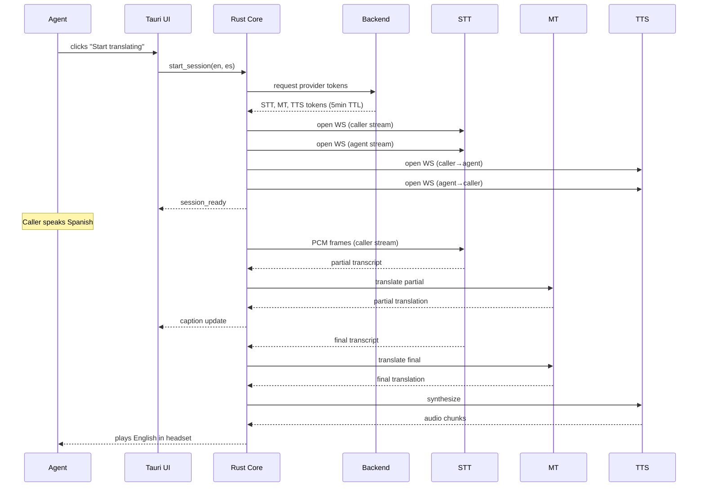
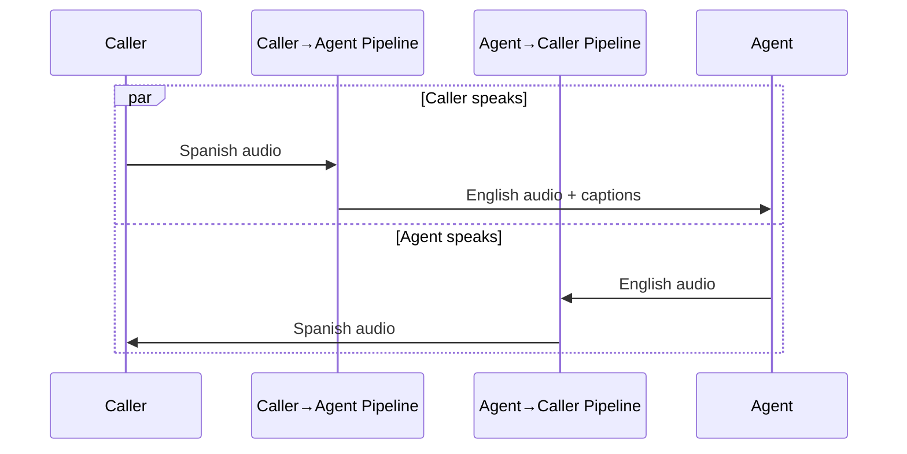
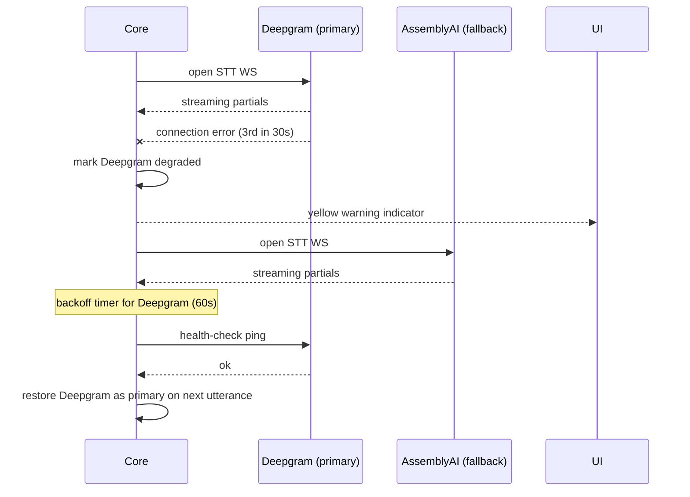
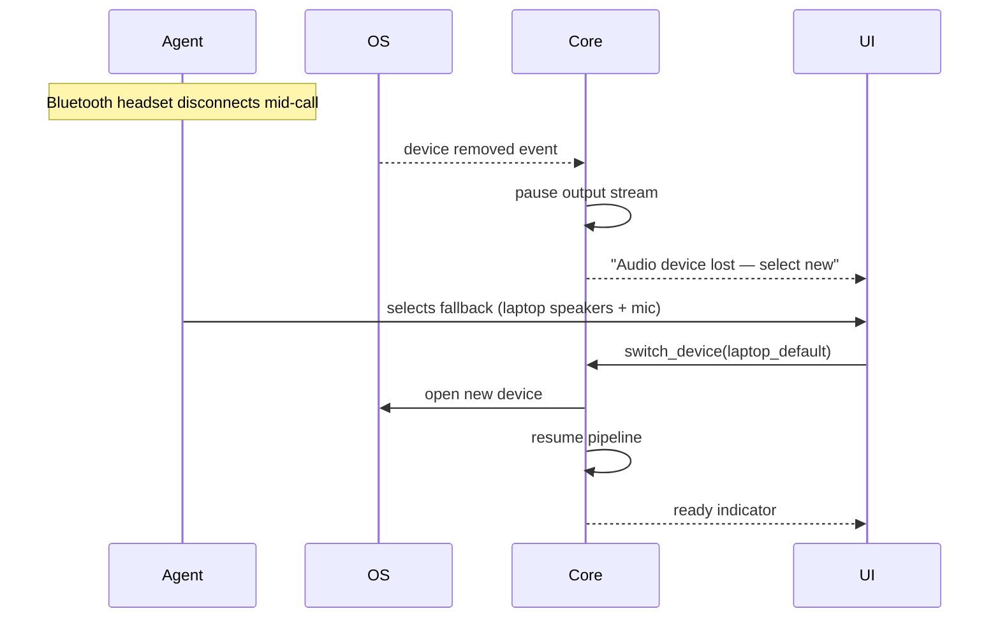

# Bridge — Technical Requirements Document (TRD)

**Document type:** Technical Requirements Document
**Version:** 0.2 (draft, architecture-level)
**Companion to:** Bridge PRD v0.1
**Audience:** Engineering team (founding engineer, contractors, design-partner tech reviewers)
**Last updated:** May 19, 2026
**Owner:** Salvation

**Changelog from v0.1:**
- New §3.5: Top Engineering Risks (ranked). Audio reliability elevated to #1 with explicit mitigation strategy.
- §4.4: `MtProvider` trait gains an opaque `Context` parameter, empty in v1, reserved for conversation continuity.
- New §4.7: Conversation Manager (Reserved). No-op layer in v1; architectural slot for v2+ pacing, continuity, and cross-direction coordination.
- §11: New "Escalation Triggers" subsection. Defines signals and control surface; policy stays in the PRD.

---

## 1. Purpose & Scope

This document defines the technical architecture for Bridge v1. It translates the product requirements in the PRD into concrete engineering decisions: components, interfaces, data flows, tech-stack choices with rationale, and the patterns we'll use to handle failure.

**This TRD covers:**
- System-wide architecture and component responsibilities
- Critical data flows and sequence diagrams
- Latency budgets allocated across components
- Build-vs-buy decisions with rationale
- Failure modes and resilience patterns
- Spike validation plan

**This TRD does NOT cover** (deferred to component-level specs):
- API contracts and message schemas
- Database schemas
- UI wireframes (separate design doc)
- Detailed test plans
- Code-level implementation

This is a living document. Expect revisions after the engineering spike (§13) and the first pilot.

---

## 2. System Context

The diagram below shows Bridge in its operating environment. Everything inside the dashed line is the agent's machine. Provider clouds and the Bridge backend are external services.

```
                          AGENT'S MACHINE
       ┌────────────────────────────────────────────────┐
       │                                                │
       │  ┌─────────┐    ┌──────────────────────────┐   │
       │  │Softphone│◄──►│  Bridge Virtual Audio    │   │
       │  │(Zendesk,│    │  Device (driver layer)   │   │
       │  │Five9,   │    └─────────────┬────────────┘   │
       │  │etc.)    │                  │                │
       │  └─────────┘                  ▼                │
       │                  ┌────────────────────────┐    │     ┌──────────────────┐
       │                  │   Bridge Desktop App   │◄───┼────►│ Provider Clouds  │
       │                  │  (Rust core + Tauri UI)│    │     │ STT │ MT │ TTS   │
       │                  └────────────┬───────────┘    │     └──────────────────┘
       │                               │                │
       │  ┌──────────┐                 ▼                │     ┌──────────────────┐
       │  │ Headset  │◄──────  Audio routing & UI  ─────┼────►│ Bridge Backend   │
       │  │ (USB/BT) │                                  │     │ (auth, metering, │
       │  └──────────┘                                  │     │  token broker)   │
       │                                                │     └──────────────────┘
       └────────────────────────────────────────────────┘
```

**External dependencies:**
- Provider clouds: Deepgram (STT), OpenAI (MT), ElevenLabs (TTS). Fallbacks: AssemblyAI, DeepL, Azure TTS.
- Softphone application: whatever the agent already uses. Bridge does not communicate with it directly.
- Bridge backend: a single-region (us-east) service for authentication, licensing, telemetry ingestion, and provider token brokering.

---

## 3. Architectural Principles

These are the tiebreakers we'll use throughout the build:

1. **Audio path stays out of garbage-collected runtimes.** All latency-critical code (capture, VAD, jitter buffer, mixing) is Rust. JavaScript and Python never sit in the audio hot path.
2. **The driver is dumb. The core is smart.** The virtual audio device just moves PCM. All signal processing, VAD, and orchestration lives in the Rust core.
3. **Fail open to passthrough.** When in doubt, route raw audio through. Silence is worse than untranslated audio. Every failure mode has a path back to "the call still works, just not translated."
4. **Captions are first-class output, not an afterthought.** The pipeline produces text and audio in parallel. UI consumes text the moment partials are available, well before TTS finishes.
5. **Providers are interchangeable.** Every external service sits behind an adapter trait. Assume we'll swap Deepgram, OpenAI, or ElevenLabs at least once in the product's lifetime.
6. **Keys never on the client.** The backend brokers short-lived provider tokens. The desktop binary contains no long-lived secrets.
7. **No audio at rest.** Audio is never persisted by default. Transcripts are opt-in and encrypted.
8. **Optimize for p95, not p50.** A CS call where 1 in 20 utterances takes 3 seconds is a broken product, even if median latency is 600ms.

### 3.5 Top Engineering Risks (Ranked)

These are the risks most likely to kill the product. Ranking matters: when scope has to be triaged, the top of this list keeps its budget. Engineering should revise the ordering after the spike, but it should always be a ranked list, never an unordered set.

**1. Audio path reliability.** This is the #1 risk and by a wide margin. Bluetooth codec switching (A2DP ↔ HFP) mid-call, USB device hot-swap, sample-rate negotiation between an 8kHz softphone and a 48kHz headset, dock disconnect races, OS-level audio bugs that crash third-party apps. Users will blame Bridge for problems caused by their headset, their dock, their drivers, or their OS — and they will be operationally right to, because we're the audio app in the chain. Krisp has lived inside this problem for years and it never fully goes away.

Mitigations:
- Audio reliability is the **#1 filter** for the founding engineer hire. ML experience is secondary; CoreAudio/WASAPI experience is primary.
- Bridge ships an **in-app diagnostics panel** from v1 that surfaces device, codec, sample rate, and buffer state and exports a one-click report for support.
- The **device hot-swap path is validated in the spike**, not deferred. Same for Bluetooth disconnect/reconnect.
- We publish a **tested-headset list**. New headsets are gated through automated CI on real hardware before being declared supported.
- Support tooling captures the audio environment automatically on any user-triggered report.

**2. Latency p95 under real-world conditions.** Median latency in a lab is meaningless. Corporate VPNs, residential ISPs, audio routing through customer security stacks, regional provider latency variance — any one of these can blow the budget for the bottom 5% of calls, and that's enough to make the product feel broken. Mitigations: (a) p95 is the architectural target, not p50, (b) the spike measures across VPN/Wi-Fi/LTE explicitly, (c) provider region is selectable per customer, (d) the agent UI surfaces current latency so degraded ≠ broken in the agent's mental model.

**3. Provider concentration risk.** Every component of the translation pipeline is bought. A single API breaking change, rate-limit ceiling, or pricing shift could destabilize the product overnight. Mitigations: (a) every provider sits behind an adapter trait, (b) fallbacks for STT, MT, and TTS are pre-integrated, not theoretical, (c) pilot contracts with primary providers include SLAs and zero-retention terms.

**4. Driver install UX.** macOS notarization, Windows signing, antivirus false positives, admin elevation prompts, IT-policy blocks on audio drivers in managed environments. A perfect product nobody can install isn't a product. Mitigations: (a) we test installs on managed Windows fleets early in pilot, (b) Apple notarization is completed before first pilot, (c) we publish a deployment guide for IT admins, (d) install telemetry surfaces install-failure causes back to us.

**5. Conversational rhythm under crosstalk.** Both parties talking, both pipelines running, both TTS streams firing — the orchestrator has to coordinate or the call sounds chaotic. The Conversation Manager (§4.7) is the architectural answer, but it's reserved in v1; the spike validates that crosstalk is at least non-broken before pilots ship.

---

## 4. Component Architecture

### 4.1 Audio Driver (Native)

**Responsibility:** Expose a virtual microphone and virtual speaker to the OS so the agent's softphone can route audio through Bridge.

**Implementation:**
- **macOS:** User-space CoreAudio HAL plugin (BlackHole-style). Avoids kernel extensions and signing pain. Works on Apple Silicon and Intel.
- **Windows:** WASAPI-based virtual audio cable, similar to VB-Cable. Installed via signed installer with one admin elevation prompt.

**Interface to Rust core:** Shared-memory ring buffers — one inbound, one outbound. Lock-free, single-producer/single-consumer per direction.

**Why not Electron's `getUserMedia` or a JS-level approach?** Latency. JS-mediated audio adds 50–150ms of unpredictable jitter from garbage collection pauses. We can't afford that in the budget.

---

### 4.2 Audio Engine (Rust Core)

**Responsibility:** Capture, condition, and route audio between the driver, the translation pipeline, and the agent's headset.

**Sub-modules:**
- **Capture:** Pull PCM from the virtual driver and the headset mic.
- **VAD:** Per-stream voice activity detection (Silero v4 via ONNX, or webrtc-vad). Outputs utterance boundaries.
- **Resampler:** Normalize streams to 16kHz mono for STT; upsample TTS output to match the call codec.
- **Echo control:** Detect when the agent's headset is bleeding TTS back into the mic (the loop scenario from PRD §13 #9 / Failure Modes §11).
- **Mixer:** Combine TTS output with optional original-audio passthrough for the agent's ear.
- **Jitter buffer:** Smooth TTS playback under variable network conditions.

**Threading model:** Tokio multi-threaded runtime. Each direction (caller→agent, agent→caller) runs on dedicated tasks. The hot path uses bounded channels with backpressure.

---

### 4.3 Translation Pipeline Orchestrator

**Responsibility:** Manage the STT → MT → TTS pipeline for each direction, including partial-result handling, provider lifecycle, and failure routing.

**Per-direction state machine:**

```
IDLE
  │ (VAD detects speech)
  ▼
LISTENING ───────► STT_STREAMING
                       │
                       │ (partial result)
                       ▼
                  TRANSLATING ─────► CAPTIONS_OUT
                       │
                       │ (final result)
                       ▼
                  SYNTHESIZING ────► AUDIO_OUT
                       │
                       │ (utterance done)
                       ▼
                     IDLE
```

One of these runs per direction, in parallel.

**Key behaviors:**
- **Streaming partials.** STT partials feed translation incrementally. Translation partials feed captions immediately. Only the *final* translation feeds TTS.
- **Revision tolerance.** STT and MT partials can revise themselves. Captions update in-place. TTS only synthesizes on stable text (sentence-final or 1.5s of stability).
- **Confidence gating.** Each utterance carries STT and MT confidence scores. Below threshold (TBD by spike) → trigger trust UI: caption-only mode, replay hint, or escalation prompt.

---

### 4.4 Cloud Bridge & Provider Adapters

**Responsibility:** Manage WebSocket connections to provider APIs, handle reconnection, and present a uniform interface to the orchestrator.

**Adapter pattern.** Every provider implements one of three traits:
- `SttProvider`: opens a streaming WebSocket, emits `Partial` and `Final` events with text + confidence.
- `MtProvider`: takes text in source language plus an opaque `Context` struct, emits translated text (may also stream partials). The `Context` is empty in v1 — the parameter exists so the trait shape doesn't change when v2 introduces conversation continuity (entity preservation, glossary persistence, tone consistency). This is a deliberate concession to avoid an orchestrator rewrite later. See §4.7 for where context will be populated.
- `TtsProvider`: takes text, streams audio chunks (PCM at a defined sample rate).

**Reconnect policy:** Exponential backoff capped at 5s. Three failures in a 30s window → mark provider degraded, route subsequent traffic to fallback.

**Token lifecycle:** All provider connections authenticate with short-lived (5-min) JWTs issued by the Bridge backend. Auto-refresh 60s before expiry.

---

### 4.5 Desktop UI (Tauri)

**Responsibility:** Render the agent's control surface and settings. Display captions. Surface trust signals (confidence warnings, replay button).

**Choice of Tauri over Electron:**

| Dimension | Tauri | Electron |
|---|---|---|
| Binary size | ~15MB | ~150MB |
| Memory baseline | ~80MB | ~300MB |
| Audio access | Rust-native | JS-bridged |
| Webview | OS-native (WKWebView/WebView2) | Bundled Chromium |

Tauri wins on every dimension that matters for a real-time desktop app.

**Communication with the core:** Tauri commands (sync) for control actions; an event stream (async) for captions, status, and confidence updates. The UI is a pure renderer — no business logic.

**Frontend stack:** React + TypeScript, kept minimal. Fewer than ten screens total.

---

### 4.6 Backend Services

**Responsibility:** Auth, licensing, provider token brokering, usage metering, admin dashboard.

**Stack:**
- Python 3.12 + FastAPI
- Postgres for accounts, licenses, usage records
- Redis for ephemeral state (token cache, rate limits)
- Single region (us-east-1) for v1

**Services:**
1. **Auth.** OIDC-based login. Per-user JWT issuance.
2. **Token broker.** On request from desktop client, mints a short-lived provider token (Deepgram, ElevenLabs, OpenAI). Backend holds the long-lived provider keys.
3. **Metering.** Ingests per-call telemetry from desktop clients. Aggregates into per-seat usage.
4. **Admin API.** Powers the operations-manager dashboard.

**What the backend explicitly does NOT do:** proxy audio. Audio goes desktop → provider directly. Routing audio through our backend would be a latency *and* cost disaster.

---

### 4.7 Conversation Manager (Reserved)

**Responsibility (v2+):** Coordinate the two per-direction pipelines as a single conversational unit. Maintain conversation-level state. Inject pacing and trust signals that don't fit inside a single utterance's pipeline.

**In v1:** This layer exists as a no-op pass-through. Per-direction orchestrators emit lifecycle events upward; the layer routes them to the UI and accepts no commands back. Cost in v1 is one indirection and a few dozen lines of glue code.

**Why reserve it now:** Several capabilities we've identified as v2+ work require state and coordination *above* the per-direction state machines. Retrofitting this layer after the per-direction orchestrators are entrenched would be expensive. The cheap concession now is to draw the architectural line so future work has a place to live. This is also where most of the "where Bridge wins over Apple/Google in two years" features will land — treat it as the moat-shaped slot.

**Capabilities that will live here (v2+):**
- **Conversation continuity.** Maintain a rolling set of entities (names, account numbers, product terms), a per-call glossary, and detected speaker register (formal *usted* vs. informal *tú*). Populates the `Context` struct passed to `MtProvider`.
- **Cross-direction coordination.** Duck own TTS when the other party starts an utterance. Suppress own TTS during sustained crosstalk. Optionally insert backchannel audio (e.g., "uh-huh") if the agent stays silent past a threshold while the caller is speaking.
- **Repeated-mistake detection.** Track when the same entity is being mistranslated across utterances. Flag for replacement or escalation.
- **Conversation-level confidence.** A rolling signal across both directions, used to decide when to surface escalation prompts (see §11 Escalation Triggers).

**What it will NOT do:** It is not a second translation model. It does not rewrite outputs from the per-direction pipelines. It coordinates and decorates.

**Interface contract (v1, even though no-op):**
- Per-direction orchestrators emit upward: `UtteranceStarted`, `PartialReady`, `FinalReady`, `TtsStarted`, `TtsCompleted`, `ConfidenceScore`.
- Conversation Manager exposes: `enqueue_event(event)` (always accepted in v1, no-op processing) and `subscribe_commands(direction)` (returns empty stream in v1).

Defining the contract now — even with no-op implementations behind it — is what keeps the v2 work from requiring an orchestrator rewrite.

---

## 5. Key Data Flows

### 5.1 Call Start & First Translated Utterance



**Latency target for first utterance:** ~1200ms (cold WebSockets). Steady state: ≤ 800ms.

---

### 5.2 Bidirectional Steady State

Both directions run independently. They happen concurrently, not sequentially.



**Crosstalk handling.** Each direction has its own VAD. When both speakers talk simultaneously, both pipelines run in parallel. Translated audio for the agent plays into the agent's headset (physically isolated from their mic by the headset itself). Translated audio for the caller plays into the softphone outbound stream. The two streams never collide acoustically because of headset isolation.

The remaining problem is *cognitive* crosstalk — both parties hearing translated voices over their own ongoing speech. UX mitigation (to be specified in PRD v0.2): visible "they're talking now" indicator + optional ducking of own TTS volume by 30% when the other party is mid-utterance.

---

### 5.3 Provider Failover



**Goal:** Failover completes in under 2 seconds. The agent never sees a dropped call, just a brief warning indicator while the system switches lanes.

---

### 5.4 Device Hot-Swap



**Critical property:** pipeline state (in-flight STT, MT, TTS connections) is preserved across the device swap. Only the physical I/O changes. The agent may miss 1–2 seconds of audio but the call continues.

This is one of the highest-risk areas in the product — Bluetooth instability and codec re-negotiation are where most audio-product bug reports originate. Heavily validated in the spike (§13).

---

## 6. Latency Architecture

End-to-end target: **p50 ≤ 800ms, p95 ≤ 1200ms** from speaker's mouth to listener's ear.

| Stage | Budget (p50) | Where it runs | Notes |
|---|---|---|---|
| Audio capture + framing | 30ms | Driver + Rust core | 20ms frames, 10ms overlap |
| VAD + utterance boundary | 70ms | Rust core | Silero with 50ms lookahead |
| Network → STT first partial | 250ms | Provider cloud | Dominated by provider |
| MT first partial | 200ms | Provider cloud | GPT-4o-mini streaming |
| TTS first chunk | 200ms | Provider cloud | ElevenLabs Flash v2.5 |
| Jitter buffer + playback | 50ms | Rust core | Tunable |
| **Total** | **800ms** | | |

**Where buffering happens:**
- 50ms input jitter buffer between driver and VAD (absorbs OS scheduling jitter).
- 50ms output jitter buffer between TTS and driver (absorbs provider chunk-size variance).
- No buffering between providers — we're already paying the network round-trip.

**When a stage blows budget:**
- STT slow → emit captions anyway, delay TTS only.
- TTS slow → start playback on first chunk, accept brief gaps over silence.
- MT slow → worst case; orchestrator emits an "interpreting…" caption rather than dead air.

---

## 7. State & Session Management

**Where state lives:**
- **Call state machine** (per direction): Rust core. Single source of truth.
- **UI state:** Tauri frontend, derived from core events. Stateless renderer.
- **Session metadata** (user, license, language pair): Rust core, hydrated from backend on app start.
- **Provider connections:** Rust core, lifecycle-managed by orchestrator.

**No persistence on the client** except:
- Encrypted preferences (default language pair, voice choice, hotkeys).
- Telemetry buffer (offline-resilient, batched to backend).

**Backend state:** Postgres holds long-term records (accounts, licenses, aggregated usage). Redis holds ephemeral state (active sessions for usage caps, rate limits). No call content ever touches backend storage.

---

## 8. Security Architecture

**Threat model assumptions:**
- The desktop binary is reverse-engineerable. Treat it as untrusted code.
- The network is hostile. All traffic is TLS.
- Provider API keys are the highest-value secret. They never leave the backend.

**Mechanisms:**
- **Token brokering.** Client requests a 5-min provider token per session. Backend signs and returns. Provider validates token before opening WebSocket.
- **No long-lived secrets on disk.** Refresh tokens stored in OS keychain (macOS Keychain, Windows Credential Manager).
- **Transport.** TLS 1.3 everywhere. WSS for provider connections.
- **Audio.** Never persisted client-side. Streamed to providers under each provider's data-handling agreement (negotiate zero-retention terms for STT/MT/TTS in pilot contracts).
- **Transcripts (opt-in).** AES-256 at rest, customer-managed keys for enterprise tier.

**Compliance roadmap:**
- SOC 2 Type I: within 12 months of launch.
- HIPAA / PCI: v3 work, separate signed BAAs with all providers.

---

## 9. Observability

**Three signal types:**

**Metrics (client → backend).**
- Per-utterance: STT confidence, MT confidence, end-to-end latency by stage, provider used, retry count.
- Per-session: total minutes, language pair, error counts.
- Per-device: OS version, hardware, audio device manufacturer.

**Traces.**
- Each utterance gets a trace ID propagated through STT/MT/TTS calls.
- Backend stores a 7-day rolling window of traces for debugging.
- Span tags include confidence scores and provider IDs for correlation analysis.

**Logs.**
- Structured JSON, log levels configurable.
- No PII, no transcript content, no audio.
- Client logs ship to backend on crash + on agent-triggered "report issue."

**Dashboards (operations-manager view):**
- Per-team: latency p50/p95, low-confidence rate, error rate.
- Per-agent: minutes used, sessions, error rate (no transcript content).
- Provider health: success rate, latency by provider.

---

## 10. Deployment Topology

**Desktop client:**
- Distribution: signed installers (DMG for macOS, MSI for Windows). Notarized on macOS.
- Auto-update via Tauri's built-in updater. Signed manifests.
- Telemetry-driven phased rollout per release: 10% → 50% → 100%.

**Backend (v1):**
- AWS us-east-1, single region.
- ECS Fargate for FastAPI services. Three services: auth, broker, metering.
- RDS Postgres (single-AZ for v1, upgrade to multi-AZ at first paid customer).
- ElastiCache Redis for tokens and rate limits.
- CloudFront in front of static assets (installer downloads, marketing site).

**Why single region for v1:** No customers yet. Multi-region adds complexity that's only valuable post-PMF.

**Capacity assumption (v1):** ≤ 500 concurrent active sessions. Token broker is stateless and scales horizontally trivially. Bottleneck is more likely to be provider rate limits than our own infra.

---

## 11. Failure Modes & Resilience Patterns

This section translates the failure modes identified in PRD review into technical patterns.

| Failure | Detection | Response | Agent-visible behavior |
|---|---|---|---|
| Provider WS drops | Connection event | Reconnect with backoff, failover after 3 fails | Yellow indicator |
| STT confidence low (<0.6) | Per-utterance score | Captions only, skip TTS, prompt "ask to repeat?" | Confidence pill on caption |
| MT output looks wrong | Heuristic (length ratio, language detect) | Fall back to literal mode, surface original text | "Translation uncertain" badge |
| Third language detected | Language ID on STT | Pause translation, surface "Caller switched to {X}" prompt | Banner with options |
| Audio loop (TTS bleeds into mic) | Cross-correlation between TTS output and mic input | Duck mic input during TTS, alert agent | Echo indicator |
| Latency drift, one direction | Rolling p95 per direction | Restart that pipeline only, preserve the other | "Re-syncing" toast |
| Device disappears | OS event | Pause, prompt device picker | Modal: "Pick new device" |
| Network loss | TCP timeout | Pause, retry, show offline indicator | Red banner |
| Provider degraded (slow) | Rolling p95 threshold | Switch to fallback provider | Yellow indicator |
| Agent kill switch (hotkey) | Global hotkey | Force passthrough mode immediately | Mode badge changes |

**Two patterns appear throughout:**
1. **Fail open to passthrough.** Whenever the translation pipeline fails, raw audio still flows. The call never drops because of Bridge.
2. **Surface, don't hide.** Every degraded state is visible to the agent with a one-glance indicator. Silent fallbacks erode trust faster than visible warnings.

### Escalation Triggers

The PRD owns the *policy* for when to admit uncertainty and hand off to a human interpreter. The TRD owns the *signals* that policy uses and the *control surface* the agent has.

**Signals the system emits** (consumed by the agent UI in v1; by the Conversation Manager and policy engine in v2+):

| Signal | Source | Available in |
|---|---|---|
| Per-utterance STT confidence | STT provider | v1 |
| Per-utterance MT confidence (heuristic: length ratio, language ID round-trip) | MT post-processor | v1 |
| Rolling p95 latency per direction | Orchestrator | v1 |
| Sustained crosstalk (>5s simultaneous speech) | VAD aggregator | v1 |
| Repeated entity mistranslation | Conversation Manager | v2 |
| Out-of-vocabulary terminology | MT post-processor | v2 |
| Frustration markers (lexical: "I don't understand," repeated please-repeat) | MT post-processor | v2 |
| Conversation-level confidence trend | Conversation Manager | v2 |

**Control surface the agent always has** (v1):
- **Hotkey kill switch.** Forces passthrough mode immediately. Survives any pipeline state.
- **"Get human interpreter" button.** Opens whatever URL or dialer the customer's admin has configured. v1 is a configurable URL; v2 integrates directly with LanguageLine or similar.
- **Replay last utterance.** Re-plays the last TTS output. Useful when a network glitch drops audio but the caption is visible.
- **Caption-only mode toggle.** Suppresses TTS, captions continue. Useful in low-confidence stretches.

The escalation philosophy itself — which combinations of signals trigger which UX response, and when the system should proactively suggest escalation — lives in the PRD. The TRD guarantees that the signals are produced and the control surface is wired up.

---

## 12. Build vs Buy Decisions

| Component | Decision | Rationale |
|---|---|---|
| STT | Buy (Deepgram, AssemblyAI fallback) | Provider quality already exceeds CS-call needs. Self-hosted Whisper is 3–5x more expensive at our latency target. |
| MT | Buy (GPT-4o-mini, DeepL fallback) | Context-aware translation needs frontier-model quality. |
| TTS | Buy (ElevenLabs, Azure fallback) | Voice quality is the user-facing surface. Open models (Coqui, XTTS) lag perceptibly. |
| Audio driver | Build | No commercial product exposes the interfaces we need. HAL plugin pattern is small and well-understood. |
| Audio engine | Build | Latency and routing pattern require custom code. |
| Tauri shell | Buy (framework) | No reason to reinvent. |
| Backend infra | Buy (AWS managed services) | Operating Postgres ourselves is a tax we shouldn't pay. |
| Auth | Buy (WorkOS or Auth0) | Enterprise SSO needed from day one. |
| Telemetry pipeline | Buy (Datadog or Honeycomb) | Engineering team is small. |
| Voice cloning (v2) | Buy (ElevenLabs Voice Lab) | Same provider; same data path. |

**Buy bias is intentional.** v1's competitive advantage is *not* in beating Deepgram on Spanish STT. It's in the audio plumbing, agent UX, and trust layer. Time spent self-hosting models is time not spent on the things that actually differentiate.

---

## 13. Spike Validation Plan

**Duration:** 2 weeks (Weeks 1–2 of engineering work).

**Output:** A spike memo with recommendations. Not a working prototype — a learning document with go/no-go signals on each item.

| Item | Method | Go/No-Go Criterion |
|---|---|---|
| Virtual audio device on macOS (Intel + Apple Silicon, latest 2 OS versions) | Build minimal HAL plugin, route audio through it | Audio flows with <30ms added latency; no kernel-extension prompts |
| Virtual audio device on Windows 10/11 | WASAPI virtual cable, signed test install | Same: <30ms added latency, single elevation prompt |
| STT provider benchmark | 100-utterance CS-style eval set (Spanish, multiple accents) | Top provider hits ≥90% transcription accuracy at <300ms first-partial |
| End-to-end latency under typical conditions | Stitched pipeline measured on residential Wi-Fi, corporate VPN, LTE tether | p50 ≤ 900ms in all three conditions |
| Bluetooth headset stability | 60-min calls with 5 disconnect/reconnect events | Pipeline recovers in ≤ 3s; zero crashes |
| USB headset hot-swap | Mid-call switch between two USB headsets | Pipeline recovers in ≤ 3s |
| Crosstalk handling | Scripted scenario: both speakers talk simultaneously for 10s | Both directions produce intelligible output; no acoustic feedback |
| Echo / loop detection | Force a feedback-loop scenario deliberately | Detected and ducked within 2s |
| CPU usage 60-min call | Activity Monitor / Task Manager logging | ≤ 15% CPU sustained on a 2020-era laptop |
| Tauri vs Electron benchmark | Side-by-side same UI in both, measure cold start + memory | Confirm Tauri picks documented advantages |

**Deliverable:** A 5-page memo containing:
- Result on each item (pass / fail / partial).
- For partials and fails: what we'd need to fix and rough effort estimate.
- A revised latency budget if measurements diverge from §6 targets.
- A go/no-go recommendation on the v1 architecture, with named risks.

---

## 14. Open Technical Questions

Tagged by owner:

| # | Question | Owner |
|---|---|---|
| T1 | macOS audio driver: is the HAL plugin (user-space) sufficient, or do we need a system extension? | Founding eng (spike) |
| T2 | Windows: license VB-Audio's driver, or build our own? | Founding eng (spike) |
| T3 | Cheapest viable model for continuous language ID (for third-language detection)? | Founding eng (spike) |
| T4 | Streaming partial revisions in TTS: pause and resynthesize, or commit and live with it? | Founding eng (post-spike) |
| T5 | OS keychain: cross-platform abstraction, or two separate implementations? | Founding eng (post-spike) |
| T6 | Telemetry vendor (Datadog vs. Honeycomb vs. Grafana Cloud)? | Founder (week 3) |
| T7 | Provider contract terms — does zero-retention require a pricing premium? | Founder (week 1) |
| T8 | VAD: Silero v4 via ONNX in Rust, or webrtc-vad? | Founding eng (spike) |
| T9 | Latency under common corporate VPN configurations — does the budget hold? | Founding eng (spike) |

---

## 15. Glossary

- **HAL plugin** — macOS user-space audio driver mechanism; lets a plain installer expose a virtual audio device without kernel access.
- **WASAPI** — Windows Audio Session API; modern audio interface used by virtual audio cable drivers.
- **VAD** — Voice Activity Detection; detects when someone is speaking vs. silent.
- **Streaming partials** — Intermediate results from a streaming API (STT or MT), emitted before the final result is known.
- **Token broker** — Backend service that issues short-lived provider credentials to clients on demand.
- **Jitter buffer** — Small audio buffer that smooths out timing variance.
- **Codec re-negotiation** — When a Bluetooth audio device switches between codecs (e.g., A2DP for music, HFP for calls), often causing audio interruption.
- **STT / MT / TTS** — Speech-to-Text / Machine Translation / Text-to-Speech.
- **OIDC** — OpenID Connect; the standard identity protocol Bridge backend will use for SSO.
